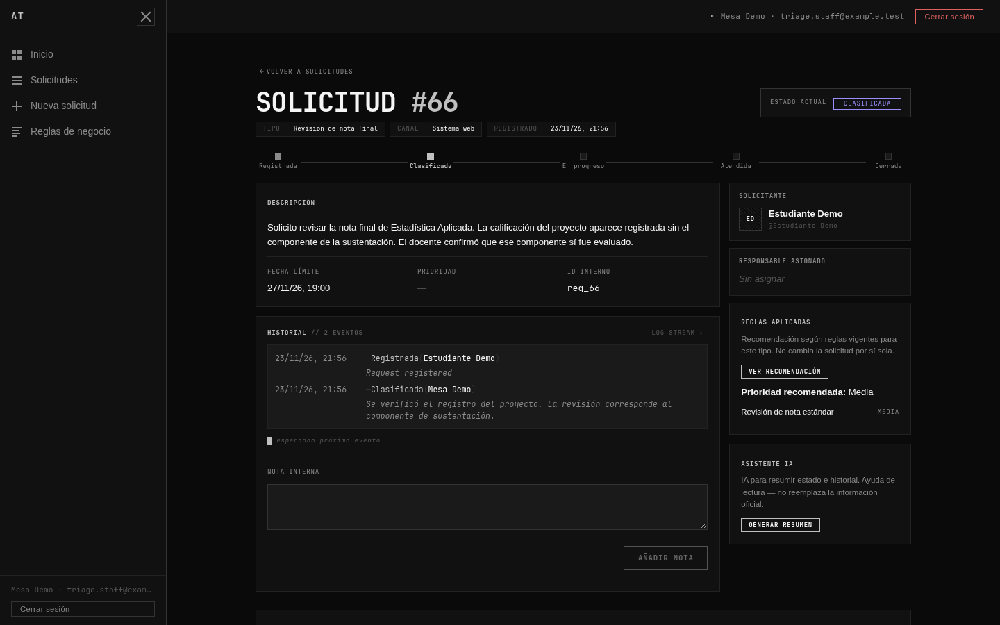
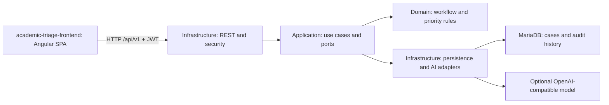

<!-- markdownlint-disable-next-line MD041 -->
<div align="center">

<h1>Academic Triage · API</h1>

<p><strong>The request workflow and audit history behind Universidad del Quindío’s academic service desk.</strong></p>

<p>
<a href="https://github.com/diegnghtmr/academic-triage-system/actions/workflows/ci-cd.yml"></a>


<a href="LICENSE"></a>
</p>

<p>
<a href="https://diegnghtmr.me/en/work/academic-triage/"><strong>Case study</strong></a> &bull;
<a href="#quick-start"><strong>Quick start</strong></a> &bull;
<a href="#architecture"><strong>Architecture</strong></a> &bull;
<a href="https://github.com/diegnghtmr/academic-triage-frontend"><strong>Frontend repo</strong></a>
</p>

</div>

<p align="center"></p>

<p align="center"><em>The API supplies the history and priority recommendation shown in the companion web app.</em></p>

A service desk needs to know who handled a request, why it changed state, and what still needs attention. This API gives students, staff, and administrators one workflow from intake to closure, with a recorded history for each case. The Java domain checks transitions and recommends priorities independently of the web client and any AI provider.

## Features

- **Request lifecycle.** Register, classify, prioritize, assign, attend, close, cancel, or reject a case under explicit transition rules.
- **Auditable decisions.** Keep a history of who changed a request and prevent terminal cases from re-entering the workflow.
- **Explainable priority.** Evaluate all active rules, return the highest matching priority and its rules, and leave the final choice to staff.
- **Roles and administration.** Authorize `STUDENT`, `STAFF`, and `ADMIN` with JWTs; administrators manage catalogs, intake channels, rules, and staff or administrator accounts.
- **Operational reports.** Expose dashboard data and administrator reports for workload, status, priority, and resolution time.
- **Concurrent updates.** Lock a case while applying a mutation and use HTTP preconditions and idempotency on the operations that require them.
- **Optional AI.** Let staff request a classification suggestion and staff or administrators request a summary without making the rest of the service depend on an AI provider.

## Quick start

Install Git and Docker with Compose. The image builds the API; the host JVM workflow below requires JDK **21** and uses the checked-in Gradle **8.12** wrapper.

```sh
git clone https://github.com/diegnghtmr/academic-triage-system.git
cd academic-triage-system
docker compose up --build -d
docker compose ps
curl http://localhost:8080/actuator/health
```

Open [Swagger UI](http://localhost:8080/swagger-ui.html). The Compose stack uses the `dev` profile by default; it applies the development Flyway migrations with demo users, catalogs, rules, and cases. That dataset, including its administrator account, is not part of the shared migrations. Use it only locally and consult the development migrations for sign-in. Optional Adminer: `docker compose --profile tools up --build -d`, then open <http://localhost:8081>. To use the host JVM instead:

```sh
docker compose up -d mariadb
SPRING_PROFILES_ACTIVE=dev ./gradlew bootstrap:bootRun
```

Supply local overrides from the shell or use `.env.example` as the basis for local configuration. Use matching database settings for MariaDB and the API; never commit your `.env` file.

| Variable | Purpose | Default |
| --- | --- | --- |
| `DB_URL` | MariaDB JDBC URL. | `jdbc:mariadb://localhost:3306/triage_db`; Compose uses the `mariadb` service host |
| `DB_USER`, `DB_PASS` | Application database account. | Local development values; set your own outside the demo |
| `DB_ROOT_PASS` | MariaDB root password for Compose. | Local development value; set your own outside the demo |
| `JWT_SECRET` | JWT signing key. | Required outside the development setup |
| `JWT_EXPIRATION_MS` | JWT lifetime in milliseconds. | `86400000` |
| `SPRING_PROFILES_ACTIVE` | Profile and its Flyway configuration. | `dev` in Compose |
| `APP_CORS_ALLOWED_ORIGINS` | Comma-separated browser origins. | `http://localhost:4200` |
| `APP_DOCS_ENABLED`, `APP_DOCS_PUBLIC_ENABLED` | Enable Swagger and control public access. | `false` in base config; enabled and public in local Compose |
| `APP_AI_PROVIDER`, `SPRING_AI_MODEL_CHAT` | Enable the OpenAI-compatible chat adapter with `openai` in both settings. | `none` |
| `SPRING_AI_OPENAI_API_KEY` | Provider credential when AI is enabled. | Unset |
| `SPRING_AI_OPENAI_BASE_URL` | OpenAI-compatible provider URL, such as `https://openrouter.ai/api` for OpenRouter. | `https://api.openai.com` in base config |
| `SPRING_AI_OPENAI_CHAT_OPTIONS_MODEL` | Chat model selected on the provider. | `gpt-4o-mini` |

## Architecture

The API's [OpenAPI contract](docs/openapi-academic-triage.yaml) defines `/api/v1`. The framework-free `application` module orchestrates use cases through ports, and `domain` owns rules and transitions. `infrastructure` provides REST, JWT, JPA, and AI adapters; `bootstrap` wires the runtime.



### API contract

- **Request states:** `REGISTERED → CLASSIFIED → IN_PROGRESS → ATTENDED → CLOSED`, with cancellation and rejection as separate terminal paths. The [state diagram](docs/diagram_state.png) shows the full transitions; the [Postman collection](docs/postman-academic-triage-system.collection.json) provides API examples.
- **Mutations:** For creation and prioritization operations that require a key, send `Idempotency-Key`; reuse the key and matching body to replay the stored response (`Idempotency-Status: replayed`). A mismatched body returns `422`.
- **Administrative writes:** For endpoints that require it, read `ETag` from the detail response and send `If-Match` on writes. A stale version returns `412`; a missing precondition returns `428`.
- **AI:** `POST /api/v1/ai/suggest-classification` suggests a type and `GET /api/v1/ai/summarize/{requestId}` returns a summary cached by request version. Expect `503` when the provider is disabled or unavailable; priority recommendations still use the deterministic rules.

## Tech stack

| Layer | Technology |
| --- | --- |
| Runtime and API | Java 21, Spring Boot 3.5.9, Spring Security, JWT, Springdoc OpenAPI |
| Data | MariaDB 11, Spring Data JPA / Hibernate, Flyway, MapStruct |
| AI | Spring AI 1.1.4, optional OpenAI-compatible provider |
| Build and checks | Gradle 8.12, JUnit 5, AssertJ, Mockito, Testcontainers, ArchUnit, WireMock, JaCoCo |

## Testing

```sh
./gradlew spotlessCheck
./gradlew test jacocoRootReport
./gradlew bootstrap:bootJar
```

[CI](.github/workflows/ci-cd.yml) runs these checks and uploads the aggregate JaCoCo report from `build/reports/jacoco/root/`. This report does not enforce a coverage threshold. Module tests can be selected individually (for example `./gradlew domain:test`), and `./gradlew infrastructure:test --tests '*ArchitectureTest*'` checks boundaries. Use Docker for container-backed tests.

For a **disposable local stack**, [docker-smoke.sh](scripts/docker-smoke.sh) probes health, Swagger, registration, login, catalogs, and request creation/listing. [docker-persistence-check.sh](scripts/docker-persistence-check.sh) checks that cases survive service restarts. [smoke-concurrency-idempotency.sh](scripts/smoke-concurrency-idempotency.sh) and [audit-idempotency.sql](scripts/audit-idempotency.sql) cover request replay and concurrent writes.

## Related repositories

- [academic-triage-frontend](https://github.com/diegnghtmr/academic-triage-frontend) — Angular client for students, staff, and administrators.

## Team

Built at Universidad del Quindío by [Diego Alejandro Flores Quintero](https://github.com/diegnghtmr), [Juan Pablo Mora Ramirez](https://github.com/diegnghtmr/academic-triage-system/commit/6c1ec8ef510c310ee79a0ef55ac889f5214b5ec4), and [Brahian Steven Mosquera Valanta](https://github.com/diegnghtmr/academic-triage-system/commit/f71e8e009c020a5f3d58ef56df39b9e9282b2c90).

## License

Released under the [MIT License](LICENSE).
